# SmartVoice — Database Design Document

## 1. ภาพรวม

ระบบใช้ SQLite เป็นฐานข้อมูล local โดย schema ที่เอกสารนี้อธิบายคือ **effective schema หลัง migration แล้ว**

| รายการ | รายละเอียด |
|---|---|
| DBMS | SQLite 3 |
| จำนวนตาราง | 9 (ข้อมูลธุรกิจ 7 + `users` + `audit_log`) |
| การลบข้อมูล | `customers` / `warranty_registrations` / `sales_orders` เป็น soft delete (`deleted_at`) · `users` ใช้ปิดใช้งาน (`is_active`) · `audit_log` เขียนเพิ่มอย่างเดียว |
| Encoding | UTF-8 |
| Timezone | UTC เก็บเป็น ISO 8601 text |

---

## 2. ER Diagram

```mermaid
erDiagram
    customers {
        INTEGER id PK
        TEXT first_name
        TEXT last_name
        TEXT phone UK
        TEXT email
        TEXT gender
        TEXT date_of_birth
        TEXT address
        TEXT subdistrict
        TEXT district
        TEXT city_province
        TEXT country
        TEXT postcode
        TEXT nick_name
        TEXT channel
        TEXT created_at
        TEXT deleted_at
        TEXT deleted_by
    }

    warranty_registrations {
        INTEGER id PK
        TEXT registration_no UK
        INTEGER customer_id FK
        TEXT channel
        TEXT certificate_no
        TEXT category
        TEXT brand
        TEXT model
        TEXT size
        TEXT sku
        TEXT serial_no
        TEXT label_no
        INTEGER warranty_period_months
        TEXT date_of_purchase
        TEXT date_of_delivery
        TEXT purchase_channel
        TEXT order_number
        TEXT expiry_date
        TEXT remark
        TEXT ref_id
        TEXT so_number
        TEXT status
        TEXT cancelled_at
        TEXT cancelled_by
        TEXT proof_path
        TEXT created_at
        TEXT deleted_at
        TEXT deleted_by
        INTEGER hidden_with_customer
    }

    sales_orders {
        INTEGER id PK
        TEXT so_number UK
        TEXT document_date
        TEXT order_date
        TEXT shipment_date
        TEXT promised_delivery_date
        TEXT due_date
        TEXT currency
        TEXT sales_type
        TEXT purchasing_type
        TEXT salesperson
        TEXT external_doc
        TEXT credit_term
        TEXT customer_po_no
        TEXT sell_to_no
        TEXT sell_to_name
        TEXT sell_to_address
        TEXT sell_to_contact
        TEXT sell_to_phone
        TEXT ship_to_name
        TEXT ship_to_address
        TEXT ship_to_contact
        TEXT ship_to_phone
        TEXT ship_to_email
        REAL total
        REAL discount
        REAL net_amount
        REAL vat
        REAL grand_total
        TEXT remark
        INTEGER customer_id FK
        TEXT created_at
        TEXT updated_at
        TEXT created_by
        TEXT deleted_at
        TEXT deleted_by
    }

    sales_order_lines {
        INTEGER id PK
        INTEGER sales_order_id FK
        INTEGER line_no
        TEXT item_no
        TEXT description
        TEXT requested_delivery_date
        TEXT uom
        TEXT location
        REAL quantity
        REAL unit_price
        REAL discount
        REAL amount
    }

    calls {
        INTEGER id PK
        TEXT filename
        TEXT file_hash UK
        TEXT file_path
        TEXT transcript
        TEXT summary
        TEXT sentiment
        TEXT topic
        TEXT topic_detail
        TEXT speaker_mapping
        TEXT agent_performance
        TEXT keywords
        TEXT brand_mentions
        TEXT platform_mentions
        INTEGER anomaly_detected
        TEXT anomaly_reason
        TEXT sentiment_reason
        TEXT anomaly_severity
        TEXT customer_phone
        INTEGER case_id FK
        TEXT processing_step
        TEXT uploaded_by
        TEXT uploaded_by_role
        TEXT status
        TEXT error_msg
        TEXT created_at
        TEXT updated_at
    }

    cases {
        INTEGER id PK
        INTEGER customer_id FK
        TEXT subject
        TEXT status
        TEXT assignee_username
        TEXT assignee_name
        TEXT assigned_at
        TEXT closed_by
        TEXT closed_at
        TEXT created_at
        TEXT updated_at
    }

    call_customer_links {
        INTEGER id PK
        INTEGER call_id FK
        INTEGER customer_id FK
        INTEGER warranty_id FK
        TEXT matched_by
        TEXT created_at
    }

    users {
        INTEGER id PK
        TEXT username UK
        TEXT display_name
        TEXT role
        TEXT password_hash
        INTEGER is_active
        TEXT created_at
        TEXT updated_at
        TEXT last_login_at
    }

    audit_log {
        INTEGER id PK
        TEXT actor
        TEXT actor_role
        TEXT action
        TEXT entity
        INTEGER entity_id
        TEXT entity_label
        TEXT changes
        TEXT created_at
    }

    customers ||--o{ warranty_registrations : "ลงทะเบียนรับประกัน"
    customers ||--o{ call_customer_links : "มี"
    customers ||--o{ cases : "มีเคส"
    cases ||--o{ calls : "จัดกลุ่มสาย"
    calls ||--o{ call_customer_links : "เชื่อมกับ"
    warranty_registrations ||--o{ call_customer_links : "อ้างอิง"
    customers ||--o{ sales_orders : "สั่งซื้อ"
    sales_orders ||--o{ sales_order_lines : "มีรายการสินค้า"
```

---

## 3. Data Dictionary

### `calls`

| Column | Type | Constraint / Meaning |
|---|---|---|
| `id` | INTEGER | PK |
| `filename` | TEXT | ชื่อไฟล์เดิม |
| `file_hash` | TEXT | UNIQUE SHA-256 |
| `file_path` | TEXT | path ของไฟล์ที่ save จริง |
| `transcript` | TEXT | transcript แบบ tagged |
| `summary` | TEXT | สรุป LLM |
| `sentiment` | TEXT | `positive` / `neutral` / `negative` |
| `topic` | TEXT | หัวข้อหลัก |
| `topic_detail` | TEXT | ประเภทความเสียหายเฉพาะ — กรอกเมื่อ `topic="แจ้งปัญหาสินค้า"` เท่านั้น (ค่าใน vocabulary: `ผ้าขาด/ผ้าหุ้มชำรุด`, `เตียง/โครงหัก`, `สปริง/ฟองน้ำยุบ`, `เปื้อน/รอยขีดข่วน`, `กลิ่น/แพ้/ระคายเคือง`, `ความชื้น/น้ำท่วม`, `ขนาด/สเปคผิด`, `อื่นๆ`) — call เก่าก่อน 2026-05-26 จะเป็น NULL |
| `speaker_mapping` | TEXT JSON | mapping speaker |
| `agent_performance` | TEXT JSON | คะแนน QA + evidence + next action |
| `keywords` | TEXT JSON | issue keywords |
| `brand_mentions` | TEXT JSON | brand mentions |
| `platform_mentions` | TEXT JSON | platform/channel mentions |
| `anomaly_detected` | INTEGER | 0/1 |
| `anomaly_reason` | TEXT | เหตุผล anomaly |
| `sentiment_reason` | TEXT | เหตุผล sentiment |
| `anomaly_severity` | TEXT | `low` / `medium` / `high` |
| `customer_phone` | TEXT | เบอร์ที่ extract จาก filename |
| `case_id` | INTEGER | FK → `cases.id` |
| `processing_step` | TEXT | ข้อความสถานะที่ UI แสดง |
| `uploaded_by` | TEXT | ชื่อผู้ upload จาก login |
| `uploaded_by_role` | TEXT | role ผู้ upload |
| `status` | TEXT | `uploaded` / `processing` / `done` / `error` |
| `error_msg` | TEXT | รายละเอียด error |
| `created_at` | TEXT | เวลาที่ upload (auto case recency จะใช้ timestamp ในชื่อไฟล์ก่อน ถ้ามี) |
| `updated_at` | TEXT | เวลาที่ update ล่าสุด |

### `customers`

| Column | Meaning |
|---|---|
| `id` | PK |
| `first_name`, `last_name` | ชื่อ |
| `phone` | เบอร์โทร UNIQUE |
| `email`, `gender`, `date_of_birth` | ข้อมูลลูกค้า |
| `address`, `subdistrict`, `district`, `city_province`, `country`, `postcode` | ที่อยู่ |
| `nick_name` | ชื่อเล่น |
| `channel` | ช่องทาง/แบรนด์ที่ลูกค้าติดต่อ (เช่น Omazz) |
| `created_at` | เวลาสร้าง |
| `deleted_at` | ว่าง = ใช้งานอยู่; มีค่า = ถูกซ่อน (soft delete) แถวไม่เคยถูกลบจริง |
| `deleted_by` | username ที่กดซ่อน |

> `phone` เป็น UNIQUE ทั้งตาราง แถวที่ถูกซ่อนจึงยังจองเบอร์นั้นอยู่ — การสร้างลูกค้าด้วยเบอร์เดิมจะถูกบล็อกพร้อมข้อความให้ไปกู้คืนแทน

### `warranty_registrations`

| Column | Meaning |
|---|---|
| `id` | PK |
| `registration_no` | เลขทะเบียน UNIQUE |
| `customer_id` | FK → `customers.id` |
| `channel`, `certificate_no`, `category`, `brand`, `model`, `size` | ข้อมูลสินค้า |
| `sku`, `serial_no`, `label_no` | รหัสสินค้า |
| `warranty_period_months` | ระยะประกัน |
| `date_of_purchase`, `date_of_delivery`, `purchase_channel`, `order_number`, `expiry_date`, `remark` | รายละเอียดการซื้อ/รับประกัน (`order_number` = เลขคำสั่งซื้อของร้าน/marketplace) |
| `so_number` | เลขที่ใบสั่งขายของบริษัท — อ้างถึง `sales_orders.so_number` ด้วยข้อความ (ไม่ใช่ FK เพราะทะเบียนอาจถูกบันทึกก่อนนำเข้า SO) |
| `ref_id` | เลขอ้างอิงจากระบบลงทะเบียนรับประกันของบริษัท |
| `status` | `active` / `cancelled` (ค่าเริ่มต้น `active`) — ยกเลิกแล้วยังแสดงในระบบพร้อมสถานะ ต่างจาก `deleted_at` ที่ซ่อนออกจากทุกหน้า |
| `cancelled_at`, `cancelled_by` | เวลาและ username ที่กดยกเลิก (ล้างเมื่อเปิดใช้อีกครั้ง) |
| `proof_path` | path ไฟล์หลักฐานการซื้อใน `data/warranty_proofs/` (ตั้งชื่อด้วย SHA-256 ของไฟล์; ไฟล์เก่าไม่ถูกลบเมื่ออัปโหลดใหม่) |
| `created_at` | เวลาสร้าง |
| `deleted_at`, `deleted_by` | soft delete เหมือน `customers` |
| `hidden_with_customer` | 1 = ถูกซ่อนเพราะลูกค้าถูกซ่อน (กู้คืนพร้อมลูกค้า), 0 = Admin ซ่อนรายการนี้เอง (กู้คืนแยก) |

### `sales_orders`

หัวใบสั่งขาย (SO) ตามเอกสาร "ใบสั่งขาย" ของบริษัท (Dynamics NAV)

| Column | Meaning |
|---|---|
| `id` | PK |
| `so_number` | เลขที่ SO — UNIQUE, ใช้เป็นกุญแจตอนนำเข้าซ้ำ (อัปเดตแทนการสร้างใหม่) |
| `document_date`, `order_date`, `shipment_date`, `promised_delivery_date`, `due_date` | วันที่เอกสาร / สั่งซื้อ / จัดส่ง / สัญญาส่ง / ครบกำหนด (ISO `YYYY-MM-DD`) |
| `currency`, `sales_type`, `purchasing_type`, `salesperson`, `external_doc`, `credit_term`, `customer_po_no` | ข้อมูลการขาย |
| `sell_to_no`, `sell_to_name`, `sell_to_address`, `sell_to_contact`, `sell_to_phone` | ผู้ซื้อ (Sell-to) |
| `ship_to_name`, `ship_to_address`, `ship_to_contact`, `ship_to_phone`, `ship_to_email` | ผู้รับ / ที่อยู่จัดส่ง (Ship-to) |
| `total`, `discount`, `net_amount`, `vat`, `grand_total` | ยอดรวม, ส่วนลดท้ายบิล, ยอดหลังหักส่วนลด, VAT, ยอดรวมสุทธิ — ค่าที่ว่างคำนวณจากรายการสินค้า |
| `remark` | หมายเหตุ |
| `customer_id` | FK → `customers.id` — ผูกอัตโนมัติจากเบอร์ผู้รับ แล้วเบอร์ผู้ซื้อ, หรือ Admin ผูกเอง (ว่างได้) |
| `created_at`, `updated_at`, `created_by` | เวลาสร้าง/แก้ล่าสุด, ผู้สร้าง |
| `deleted_at`, `deleted_by` | soft delete เหมือน `customers` |

### `sales_order_lines`

| Column | Meaning |
|---|---|
| `id` | PK |
| `sales_order_id` | FK → `sales_orders.id` (`ON DELETE CASCADE` — แต่ระบบไม่ลบ SO จริง ใช้ซ่อนแทน) |
| `line_no` | ลำดับ |
| `item_no` | รหัสสินค้า/บาร์โค้ด |
| `description` | รายละเอียดสินค้า |
| `requested_delivery_date` | วันที่ต้องการรับ |
| `uom`, `location` | หน่วย, คลัง/สถานที่ |
| `quantity`, `unit_price`, `discount`, `amount` | จำนวน, ราคาต่อหน่วย, ส่วนลด (จำนวนเงิน), จำนวนเงิน |

> การบันทึก SO ซ้ำ (นำเข้าใหม่หรือแก้ในฟอร์ม) จะแทนที่รายการสินค้าทั้งชุดของ SO นั้น

### `audit_log`

| Column | Meaning |
|---|---|
| `id` | PK |
| `actor` | ใครทำ — ชื่อที่แสดงของบัญชี; ถ้าเป็น `login_failed` คือข้อความที่พิมพ์ในช่อง username (ยังไม่รู้ว่าเป็นใคร) |
| `actor_role` | role ณ ตอนนั้น (ว่างสำหรับ `login_failed`) |
| `action` | `create` / `update` / `delete` (ลูกค้า/ทะเบียน/SO = ซ่อน) / `restore` / `login` / `login_failed` / `logout` / `claim` / `release` / `cancel` / `reactivate` (สถานะทะเบียน) / `import` (นำเข้า SO จากไฟล์ — 1 แถวต่อการนำเข้า พร้อมจำนวนและเลขที่ SO) |
| `entity` | `customer` / `warranty` / `sales_order` / `user` / `call` / `case` / `session` / `settings` |
| `entity_id` | id ของแถวที่ถูกกระทำ (ว่างได้ เช่น settings) |
| `entity_label` | ชื่อ ณ ตอนนั้น — ชื่อลูกค้า, เลขทะเบียน, ชื่อไฟล์, หัวข้อเคส, หรือ username สำหรับ `user` / `session` |
| `changes` | JSON — `{field: [ก่อน, หลัง]}` สำหรับ update, snapshot สำหรับ create/delete; ค่า `password` / `password_hash` / `hf_token` ถูกแทนด้วย `***` |
| `created_at` | เวลาที่บันทึก (UTC) |

> ตารางนี้เป็น **append-only** ไม่มีโค้ดส่วนใดใน repo ที่ UPDATE หรือ DELETE แถวใน `audit_log`
> การเขียนผ่าน `audit.record()` ซึ่งไม่ raise — ถ้าเขียน log ไม่สำเร็จ action ของผู้ใช้ยังสำเร็จตามปกติ

### `call_customer_links`

| Column | Meaning |
|---|---|
| `id` | PK |
| `call_id` | FK → `calls.id`, cascade delete |
| `customer_id` | FK → `customers.id` |
| `warranty_id` | FK → `warranty_registrations.id` |
| `matched_by` | `manual` หรือ `auto_phone` |
| `created_at` | เวลาสร้าง link |

### `cases`

| Column | Meaning |
|---|---|
| `id` | PK |
| `customer_id` | FK → `customers.id` |
| `subject` | หัวข้อเคส |
| `status` | `open` / `follow_up` / `closed` |
| `assignee_username` | username ของพนักงานที่กด "รับเคส" — NULL = ยังไม่มีคนรับ (เทียบแบบไม่สนตัวพิมพ์เล็ก/ใหญ่) |
| `assignee_name` | ชื่อที่แสดงของผู้รับเคส ณ เวลาที่รับ |
| `assigned_at` | เวลาที่รับเคส (UTC) |
| `closed_by`, `closed_at` | ใครปิดเคสและเมื่อไร — ล้างเป็น NULL เมื่อเปิดเคสอีกครั้ง |
| `created_at`, `updated_at` | เวลา lifecycle ของเคส |

> รับเคสด้วย `db.claim_case()` ซึ่งเป็น `UPDATE ... WHERE assignee_username IS NULL` คำสั่งเดียว — สองคนกดพร้อมกันได้เคสแค่คนเดียว
> เปลี่ยนสถานะผ่าน `db.set_case_status_as_assignee()` ที่ตรวจเจ้าของใน `WHERE` เช่นกัน กติกาทั้งหมดอยู่ที่ `smartvoice/case_workflow.py`

### `users`

| Column | Type | Meaning |
|---|---|---|
| `id` | INTEGER | PK |
| `username` | TEXT | ชื่อที่ใช้ล็อกอิน — UNIQUE แบบไม่สนตัวพิมพ์เล็ก/ใหญ่ (`COLLATE NOCASE`) ใช้ได้เฉพาะ `a-z 0-9 . _ -` อย่างน้อย 3 ตัว |
| `display_name` | TEXT | ชื่อที่แสดงในแอปและในคอลัมน์ `actor` ของ `audit_log` |
| `role` | TEXT | `Admin` / `Supervisor` / `QA` / `Agent` — ค่าที่ไม่รู้จักถูกตีความเป็น `Agent` |
| `password_hash` | TEXT | `pbkdf2_sha256$260000$salt$hash` — ไม่มีการเก็บ plaintext |
| `is_active` | INTEGER | 1 = ใช้งาน, 0 = ปิดใช้งาน (ล็อกอินไม่ได้) — **แทนการลบบัญชี** |
| `created_at`, `updated_at` | TEXT | เวลาสร้าง / แก้ไขล่าสุด |
| `last_login_at` | TEXT | เข้าสู่ระบบสำเร็จครั้งล่าสุด |

> ไม่มีหน้าไหนในแอปลบแถวในตารางนี้ เพราะ `audit_log` อ้างถึงบัญชีเหล่านี้อยู่ — เลิกใช้บัญชีด้วย `is_active = 0`
> ต้องมี `role = 'Admin'` และ `is_active = 1` อย่างน้อย 1 แถวเสมอ (บังคับที่ `auth.would_remove_last_admin()`)
> บัญชีสำรองจาก `SMARTVOICE_USERS` ใน `.env` ไม่อยู่ในตารางนี้ ระบบตรวจตารางนี้ก่อนแล้วค่อยตกไปที่ `.env`

---

## 4. Relationship Summary

| Relationship | Cardinality |
|---|---|
| customers → warranty_registrations | 1 : N |
| customers → call_customer_links | 1 : N |
| customers → cases | 1 : N |
| cases → calls | 1 : N |
| calls → call_customer_links | 1 : N |
| warranty_registrations → call_customer_links | 1 : N |
| customers → sales_orders | 1 : N (SO ที่ยังไม่ผูกลูกค้า `customer_id` ว่าง) |
| sales_orders → sales_order_lines | 1 : N |

`users` และ `audit_log` **ไม่มี foreign key** ไปตารางอื่นโดยตั้งใจ — `audit_log` เก็บ `entity` + `entity_id` + `entity_label` (ชื่อ ณ เวลานั้น) และ `actor` เป็นข้อความ เพื่อให้ประวัติยังอ่านได้ครบแม้ข้อมูลต้นทางจะถูกแก้ชื่อหรือถูกซ่อนภายหลัง

---

## 5. Migration Notes

`calls` เริ่มจาก schema หลัก แล้ว `_migrate()` เติม columns ที่เพิ่มภายหลัง เช่น:

- `brand_mentions`
- `platform_mentions`
- `processing_step`
- `sentiment_reason`
- `anomaly_severity`
- `customer_phone`
- `case_id`
- `uploaded_by`
- `uploaded_by_role`
- `topic_detail`

`_migrate_case_assignment()` เติม `assignee_username`, `assignee_name`, `assigned_at`, `closed_by`,
`closed_at` ให้ `cases` (เคสเดิมทั้งหมดจึงเป็น "ยังไม่มีคนรับ")

`_migrate_soft_delete()` ทำแบบเดียวกันกับ `customers` (`deleted_at`, `deleted_by`) และ
`warranty_registrations` (`deleted_at`, `deleted_by`, `hidden_with_customer`) ส่วน `users` และ `audit_log`
สร้างด้วย `CREATE TABLE IF NOT EXISTS` (บัญชี `admin` เริ่มต้นถูกสร้างตอนเปิดแอป ถ้ายังไม่มีบัญชีใดเลย)

`_migrate_warranty_fields()` เติม `nick_name`, `channel` ให้ `customers` และ `ref_id`, `so_number`,
`status` (ค่าเริ่มต้น `'active'`), `cancelled_at`, `cancelled_by`, `proof_path` ให้ `warranty_registrations`
ส่วน `sales_orders` / `sales_order_lines` สร้างด้วย `CREATE TABLE IF NOT EXISTS`

ดังนั้นการเปิด DB เก่าด้วยแอปเวอร์ชันใหม่จะค่อย ๆ เติม column ที่ขาดให้เอง โดยข้อมูลเดิมยังอยู่ครบ
(`deleted_at` เป็น NULL = ทุกแถวเดิมถือว่ายังใช้งานอยู่)

---

## 6. JSON Fields

| Field | ตัวอย่าง |
|---|---|
| `speaker_mapping` | `{"SPEAKER_00": "Agent", "SPEAKER_01": "Customer"}` |
| `agent_performance` | `{"politeness": 5, "politeness_evidence": "ทำได้: ... / ไม่ได้: ...", "problem_solving": 4, "problem_solving_evidence": "ทำได้: ... / ไม่ได้: ...", "overall_score": 9, "next_action": "...", "next_action_owner": "ฝ่ายจัดส่ง"}` |
| `keywords` | `["ที่นอน", "ส่งล่าช้า"]` |
| `brand_mentions` | `["Restonic"]` |
| `platform_mentions` | `["Shopee"]` |
