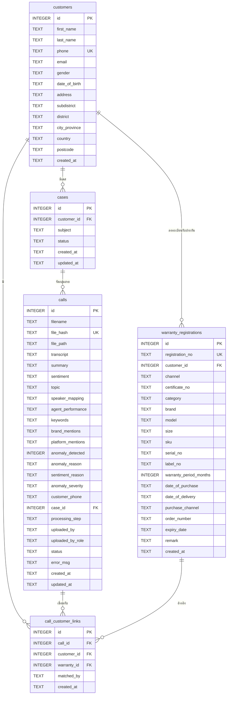

# SmartVoice — Database Design Document

## 1. ภาพรวม

ระบบใช้ SQLite เป็นฐานข้อมูล local โดย schema ที่เอกสารนี้อธิบายคือ **effective schema หลัง migration แล้ว**

| รายการ | รายละเอียด |
|---|---|
| DBMS | SQLite 3 |
| จำนวนตาราง | 5 |
| Encoding | UTF-8 |
| Timezone | UTC เก็บเป็น ISO 8601 text |

---

## 2. ER Diagram

---

## 3. Data Dictionary

### `calls`

| Column | Type | Constraint / Meaning |
|---|---|---|
| `id` | INTEGER | PK |
| `filename` | TEXT | ชื่อไฟล์เดิม |
| `file_hash` | TEXT | UNIQUE SHA-256 |
| `file_path` | TEXT | path ของไฟล์ที่ save จริง |
| `transcript` | TEXT | transcript แบบ tagged |
| `summary` | TEXT | สรุป LLM |
| `sentiment` | TEXT | `positive` / `neutral` / `negative` |
| `topic` | TEXT | หัวข้อหลัก |
| `speaker_mapping` | TEXT JSON | mapping speaker |
| `agent_performance` | TEXT JSON | คะแนน QA + evidence + next action |
| `keywords` | TEXT JSON | issue keywords |
| `brand_mentions` | TEXT JSON | brand mentions |
| `platform_mentions` | TEXT JSON | platform/channel mentions |
| `anomaly_detected` | INTEGER | 0/1 |
| `anomaly_reason` | TEXT | เหตุผล anomaly |
| `sentiment_reason` | TEXT | เหตุผล sentiment |
| `anomaly_severity` | TEXT | `low` / `medium` / `high` |
| `customer_phone` | TEXT | เบอร์ที่ extract จาก filename |
| `case_id` | INTEGER | FK → `cases.id` |
| `processing_step` | TEXT | ข้อความสถานะที่ UI แสดง |
| `uploaded_by` | TEXT | ชื่อผู้ upload จาก login |
| `uploaded_by_role` | TEXT | role ผู้ upload |
| `status` | TEXT | `uploaded` / `processing` / `done` / `error` |
| `error_msg` | TEXT | รายละเอียด error |
| `created_at` | TEXT | เวลาที่ upload (auto case recency จะใช้ timestamp ในชื่อไฟล์ก่อน ถ้ามี) |
| `updated_at` | TEXT | เวลาที่ update ล่าสุด |

### `customers`

| Column | Meaning |
|---|---|
| `id` | PK |
| `first_name`, `last_name` | ชื่อ |
| `phone` | เบอร์โทร UNIQUE |
| `email`, `gender`, `date_of_birth` | ข้อมูลลูกค้า |
| `address`, `subdistrict`, `district`, `city_province`, `country`, `postcode` | ที่อยู่ |
| `created_at` | เวลาสร้าง |

### `warranty_registrations`

| Column | Meaning |
|---|---|
| `id` | PK |
| `registration_no` | เลขทะเบียน UNIQUE |
| `customer_id` | FK → `customers.id` |
| `channel`, `certificate_no`, `category`, `brand`, `model`, `size` | ข้อมูลสินค้า |
| `sku`, `serial_no`, `label_no` | รหัสสินค้า |
| `warranty_period_months` | ระยะประกัน |
| `date_of_purchase`, `date_of_delivery`, `purchase_channel`, `order_number`, `expiry_date`, `remark` | รายละเอียดการซื้อ/รับประกัน |
| `created_at` | เวลาสร้าง |

### `call_customer_links`

| Column | Meaning |
|---|---|
| `id` | PK |
| `call_id` | FK → `calls.id`, cascade delete |
| `customer_id` | FK → `customers.id` |
| `warranty_id` | FK → `warranty_registrations.id` |
| `matched_by` | `manual` หรือ `auto_phone` |
| `created_at` | เวลาสร้าง link |

### `cases`

| Column | Meaning |
|---|---|
| `id` | PK |
| `customer_id` | FK → `customers.id` |
| `subject` | หัวข้อเคส |
| `status` | `open` / `follow_up` / `closed` |
| `created_at`, `updated_at` | เวลา lifecycle ของเคส |

---

## 4. Relationship Summary

| Relationship | Cardinality |
|---|---|
| customers → warranty_registrations | 1 : N |
| customers → call_customer_links | 1 : N |
| customers → cases | 1 : N |
| cases → calls | 1 : N |
| calls → call_customer_links | 1 : N |
| warranty_registrations → call_customer_links | 1 : N |

---

## 5. Migration Notes

`calls` เริ่มจาก schema หลัก แล้ว `_migrate()` เติม columns ที่เพิ่มภายหลัง เช่น:

- `brand_mentions`
- `platform_mentions`
- `processing_step`
- `sentiment_reason`
- `anomaly_severity`
- `customer_phone`
- `case_id`
- `uploaded_by`
- `uploaded_by_role`

ดังนั้นการเปิด DB เก่าด้วยแอปเวอร์ชันใหม่จะค่อย ๆ เติม column ที่ขาดให้เอง

---

## 6. JSON Fields

| Field | ตัวอย่าง |
|---|---|
| `speaker_mapping` | `{"SPEAKER_00": "Agent", "SPEAKER_01": "Customer"}` |
| `agent_performance` | `{"politeness": 5, "politeness_evidence": "ทำได้: ... / ไม่ได้: ...", "problem_solving": 4, "problem_solving_evidence": "ทำได้: ... / ไม่ได้: ...", "overall_score": 9, "next_action": "...", "next_action_owner": "ฝ่ายจัดส่ง"}` |
| `keywords` | `["ที่นอน", "ส่งล่าช้า"]` |
| `brand_mentions` | `["Restonic"]` |
| `platform_mentions` | `["Shopee"]` |
