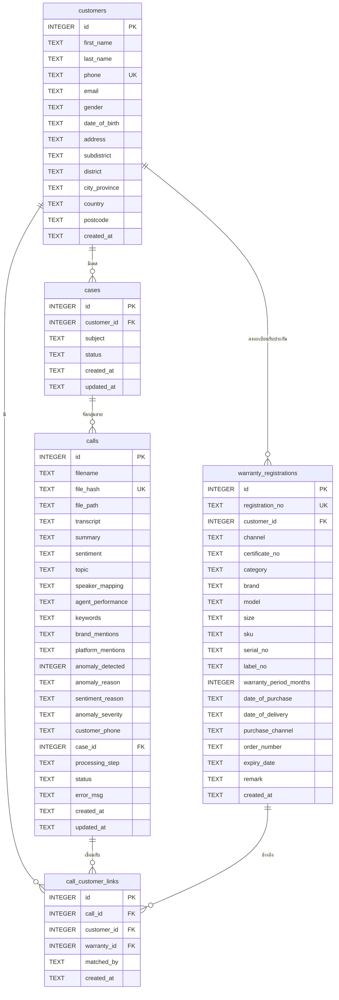

# SmartVoice — Database Design Document
## บทที่ 3: การออกแบบฐานข้อมูล

---

## 1. ภาพรวมระบบฐานข้อมูล

ระบบ SmartVoice ใช้ **SQLite** เป็น Relational Database (Local) สำหรับ Prototype โดยออกแบบให้รองรับการย้ายไป Cloud (PostgreSQL) ได้ในอนาคต

| รายการ | รายละเอียด |
|---|---|
| DBMS | SQLite 3 (Local) / PostgreSQL (Cloud-ready) |
| ประเภท | Relational Database |
| จำนวน Table | 5 |
| Encoding | UTF-8 |
| Timezone | UTC (stored as ISO 8601 TEXT) |

---

## 2. ER Diagram

---

## 3. Data Dictionary

### 3.1 Table: `calls` — บันทึกการโทร Call Center

| Column | Data Type | Constraint | คำอธิบาย |
|---|---|---|---|
| `id` | INTEGER | PK, AUTOINCREMENT | รหัสการโทรอัตโนมัติ |
| `filename` | TEXT | NOT NULL | ชื่อไฟล์เสียงต้นฉบับ |
| `file_hash` | TEXT | NOT NULL, UNIQUE | SHA-256 hash ของไฟล์ (ป้องกัน duplicate) |
| `file_path` | TEXT | NOT NULL | path ที่เก็บไฟล์เสียงในระบบ |
| `transcript` | TEXT | NULL | บทสนทนาฉบับเต็มที่ถอดเสียงแล้ว (Agent/Customer: ข้อความ) |
| `summary` | TEXT | NULL | สรุปบทสนทนาจาก LLM (1-2 ประโยค) |
| `sentiment` | TEXT | CHECK(positive\|neutral\|negative) | อารมณ์โดยรวมของลูกค้า |
| `topic` | TEXT | NULL | หัวข้อหลักที่ลูกค้าติดต่อ เช่น "ร้องเรียนสินค้าชำรุด" |
| `speaker_mapping` | TEXT (JSON) | NULL | การ map Speaker ID → บทบาท เช่น `{"SPEAKER_00": "Agent"}` |
| `agent_performance` | TEXT (JSON) | NULL | ผลประเมิน Agent: politeness, problem_solving, overall_score |
| `keywords` | TEXT (JSON) | NULL | คำสำคัญในบทสนทนา เช่น `["คืนสินค้า","ที่นอน"]` |
| `brand_mentions` | TEXT (JSON) | NULL | ชื่อแบรนด์ที่พูดถึง เช่น `["Omazz","Sealy"]` |
| `platform_mentions` | TEXT (JSON) | NULL | แพลตฟอร์มที่พูดถึง เช่น `["Shopee","Lazada"]` |
| `anomaly_detected` | INTEGER | DEFAULT 0 | 1 = พบพฤติกรรมผิดปกติ, 0 = ปกติ |
| `anomaly_reason` | TEXT | NULL | อธิบายประเภทความผิดปกติที่พบ |
| `sentiment_reason` | TEXT | NULL | เหตุผลประกอบการวิเคราะห์ sentiment |
| `anomaly_severity` | TEXT | NULL | ระดับความรุนแรงของ anomaly (low/medium/high) |
| `customer_phone` | TEXT | NULL | เบอร์ลูกค้าที่ดึงจากชื่อไฟล์อัตโนมัติ |
| `case_id` | INTEGER | FK → cases(id), NULL | รหัสเคสที่สายนี้ถูกจัดกลุ่มไว้ |
| `processing_step` | TEXT | NULL | ขั้นตอนการประมวลผลปัจจุบัน (แสดงใน UI) |
| `status` | TEXT | CHECK(uploaded\|processing\|done\|error) | สถานะการประมวลผล |
| `error_msg` | TEXT | NULL | ข้อความ error (ถ้ามี) |
| `created_at` | TEXT | NOT NULL | วันเวลาที่อัปโหลด (ISO 8601 UTC) |
| `updated_at` | TEXT | NOT NULL | วันเวลาที่อัปเดตล่าสุด (ISO 8601 UTC) |

---

### 3.2 Table: `customers` — ข้อมูลลูกค้า

| Column | Data Type | Constraint | คำอธิบาย |
|---|---|---|---|
| `id` | INTEGER | PK, AUTOINCREMENT | รหัสลูกค้าอัตโนมัติ |
| `first_name` | TEXT | NOT NULL | ชื่อจริง |
| `last_name` | TEXT | NOT NULL | นามสกุล |
| `phone` | TEXT | UNIQUE | เบอร์โทรศัพท์ (ใช้ match กับ call) |
| `email` | TEXT | NULL | อีเมล |
| `gender` | TEXT | NULL | เพศ (MALE / FEMALE) |
| `date_of_birth` | TEXT | NULL | วันเกิด (YYYY-MM-DD) |
| `address` | TEXT | NULL | ที่อยู่ (บ้านเลขที่ ถนน) |
| `subdistrict` | TEXT | NULL | แขวง / ตำบล |
| `district` | TEXT | NULL | เขต / อำเภอ |
| `city_province` | TEXT | NULL | จังหวัด |
| `country` | TEXT | DEFAULT 'Thailand' | ประเทศ |
| `postcode` | TEXT | NULL | รหัสไปรษณีย์ |
| `created_at` | TEXT | NOT NULL | วันเวลาที่สร้างข้อมูล (ISO 8601 UTC) |

---

### 3.3 Table: `warranty_registrations` — ทะเบียนรับประกันสินค้า

| Column | Data Type | Constraint | คำอธิบาย |
|---|---|---|---|
| `id` | INTEGER | PK, AUTOINCREMENT | รหัสทะเบียนอัตโนมัติ |
| `registration_no` | TEXT | NOT NULL, UNIQUE | เลขที่ทะเบียนรับประกัน เช่น W001OZ25001 |
| `customer_id` | INTEGER | FK → customers(id) | รหัสลูกค้าเจ้าของ warranty |
| `channel` | TEXT | NULL | ช่องทางลงทะเบียน (Omazz / Dunlopillo) |
| `certificate_no` | TEXT | NULL | เลขที่ใบรับประกัน |
| `category` | TEXT | NULL | หมวดหมู่สินค้า (Mattress / Pillow / Topper) |
| `brand` | TEXT | NULL | แบรนด์สินค้า (Omazz / Dunlopillo / Sealy) |
| `model` | TEXT | NULL | รุ่นสินค้า เช่น Natura Latex |
| `size` | TEXT | NULL | ขนาด เช่น 3.5ft / 5ft / 6ft |
| `sku` | TEXT | NULL | รหัสสินค้า (Stock Keeping Unit) |
| `serial_no` | TEXT | NULL | หมายเลขซีเรียล |
| `label_no` | TEXT | NULL | หมายเลขป้าย |
| `warranty_period_months` | INTEGER | DEFAULT 120 | ระยะเวลารับประกัน (เดือน) เช่น 120 = 10 ปี |
| `date_of_purchase` | TEXT | NULL | วันที่ซื้อสินค้า (YYYY-MM-DD) |
| `date_of_delivery` | TEXT | NULL | วันที่รับสินค้า (YYYY-MM-DD) |
| `purchase_channel` | TEXT | NULL | ช่องทางซื้อ (Shopee / Lazada / TikTok Shop / LINE / Store) |
| `order_number` | TEXT | NULL | หมายเลข Order |
| `expiry_date` | TEXT | NULL | วันหมดอายุรับประกัน (YYYY-MM-DD) |
| `remark` | TEXT | NULL | หมายเหตุเพิ่มเติม |
| `created_at` | TEXT | NOT NULL | วันเวลาที่ลงทะเบียน (ISO 8601 UTC) |

---

### 3.4 Table: `call_customer_links` — เชื่อมโยงการโทรกับลูกค้า

| Column | Data Type | Constraint | คำอธิบาย |
|---|---|---|---|
| `id` | INTEGER | PK, AUTOINCREMENT | รหัส link อัตโนมัติ |
| `call_id` | INTEGER | NOT NULL, FK → calls(id) ON DELETE CASCADE | รหัสการโทร |
| `customer_id` | INTEGER | NOT NULL, FK → customers(id) | รหัสลูกค้า |
| `warranty_id` | INTEGER | FK → warranty_registrations(id), NULL | รหัสทะเบียนรับประกัน (ถ้าระบุได้) |
| `matched_by` | TEXT | DEFAULT 'manual' | วิธี match: `manual` (เชื่อมด้วยมือ) / `auto_phone` (เชื่อมอัตโนมัติจากเบอร์ในชื่อไฟล์) |
| `created_at` | TEXT | NOT NULL | วันเวลาที่สร้าง link (ISO 8601 UTC) |

---

### 3.5 Table: `cases` — เคส (กลุ่มการโทรเรื่องเดียวกัน)

| Column | Data Type | Constraint | คำอธิบาย |
|---|---|---|---|
| `id` | INTEGER | PK, AUTOINCREMENT | รหัสเคสอัตโนมัติ |
| `customer_id` | INTEGER | FK → customers(id) | รหัสลูกค้าเจ้าของเคส |
| `subject` | TEXT | NOT NULL | หัวข้อเคส เช่น "สอบถามประกันน้ำท่วม" |
| `status` | TEXT | CHECK(open\|follow_up\|closed) | สถานะเคส: เปิด/ติดตาม/ปิด |
| `created_at` | TEXT | NOT NULL | วันเวลาที่สร้างเคส (ISO 8601 UTC) |
| `updated_at` | TEXT | NOT NULL | วันเวลาที่อัปเดตล่าสุด (ISO 8601 UTC) |

---

## 4. Relationship Summary

| Relationship | Cardinality | คำอธิบาย |
|---|---|---|
| customers → warranty_registrations | 1 : N | ลูกค้า 1 คน มีหลาย warranty ได้ |
| customers → call_customer_links | 1 : N | ลูกค้า 1 คน เชื่อมกับหลาย call ได้ |
| customers → cases | 1 : N | ลูกค้า 1 คน มีได้หลายเคส |
| cases → calls | 1 : N | 1 เคส จัดกลุ่มได้หลายสาย (case_id) |
| calls → call_customer_links | 1 : N | 1 call อาจเชื่อมกับลูกค้าได้ |
| warranty_registrations → call_customer_links | 1 : N | 1 warranty อ้างอิงได้จากหลาย call |

---

## 5. Database Location

| Environment | ประเภท | Path / Connection |
|---|---|---|
| Development | Local SQLite | `data/smartvoice.db` |
| Production (แนะนำ) | Cloud PostgreSQL | `postgresql://host/smartvoice` |
| Hybrid | SQLite + S3 backup | `data/smartvoice.db` + AWS S3 |

---

## 6. JSON Fields (Unstructured Data)

ข้อมูลบางส่วนใน `calls` table เก็บในรูปแบบ **JSON string** เพื่อความยืดหยุ่น:

| Field | ตัวอย่างค่า |
|---|---|
| `speaker_mapping` | `{"SPEAKER_00": "Agent", "SPEAKER_01": "Customer"}` |
| `agent_performance` | `{"politeness": 5, "problem_solving": 4, "overall_score": 9, "next_action": "ติดตามเรื่อง...", "next_action_owner": "Agent คนเดิม", "strengths": [...], "improvements": [...]}` |
| `keywords` | `["ที่นอน", "คืนสินค้า", "ชำรุด"]` |
| `brand_mentions` | `["Omazz", "Dunlopillo"]` |
| `platform_mentions` | `["Shopee", "Lazada"]` |

> **หมายเหตุ**: ใน Production อาจแยก JSON fields ออกเป็น table ย่อย เช่น `call_keywords`, `call_brands` เพื่อรองรับการ query ที่ซับซ้อน
